<!-- The SVG handles theme colors; picture media handles width and reduced motion. -->
<picture>
  <source media="(prefers-reduced-motion: reduce) and (max-width: 600px)" srcset="./assets/header-mobile-adaptive-still.svg">
  <source media="(prefers-reduced-motion: reduce)" srcset="./assets/header-adaptive-still.svg">
  <source media="(max-width: 600px)" srcset="./assets/header-mobile-adaptive.svg">
  
</picture>

### `$ whoami`

I'm a full-stack software engineer building web apps and developer tools with **React, Next.js, TypeScript, Node.js and PostgreSQL**. I work across interfaces, APIs and databases, with a focus on clear user experiences and reliable workflows.

### `$ ls selected-work`

- **[AuthVisage SDK](https://github.com/zeyadAjamy/authvisage-sdk) + [developer portal](https://github.com/zeyadAjamy/authvisage)** — Academic project: I built the SDK and portal and designed the API contract and PKCE integration.
- **[CaloLogger](https://github.com/ahmedXDR/CaloLogger)** — Collaborative frontend work covering authentication, charts, meal and weight API integrations, and tests.
- **[Record Hub](https://www.zeyadalajamy.com/projects/eas-record-hub)** — Case study: document-grounded AI retrieval with access checks and recipient-level email recovery.
- **[Elfarouk / Rota](https://www.zeyadalajamy.com/projects/01923fa6-9874-78ef-afb5-6248276dd305)** — Case study: I owned the current implementation of two live English/Arabic platforms for one client with multiple companies.

### `$ connect`

[Portfolio](https://www.zeyadalajamy.com/) · [LinkedIn](https://www.linkedin.com/in/zeyad-alajamy/) · [Email](mailto:me@zeyadalajamy.com)

Open to remote full-stack roles and freelance projects.
